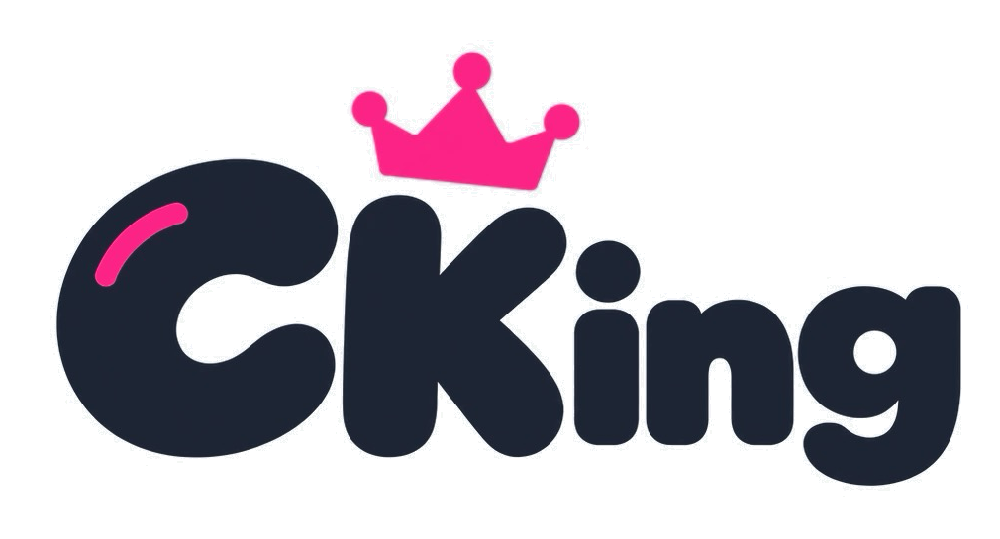
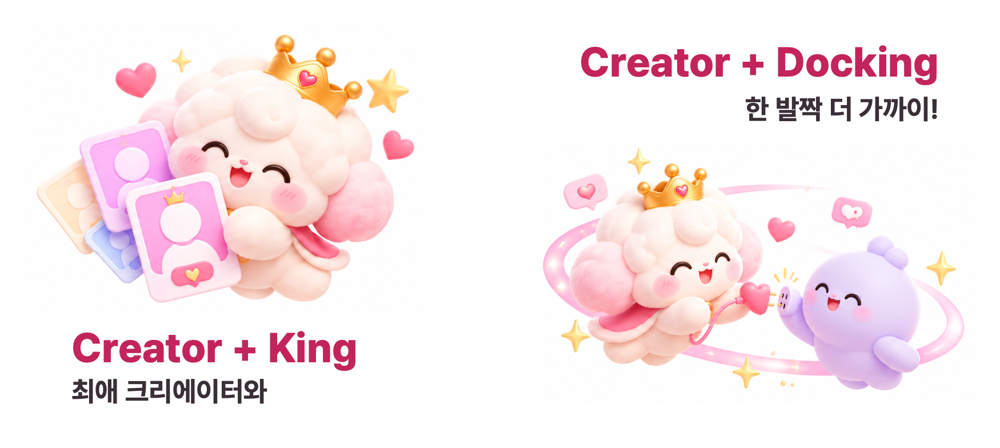
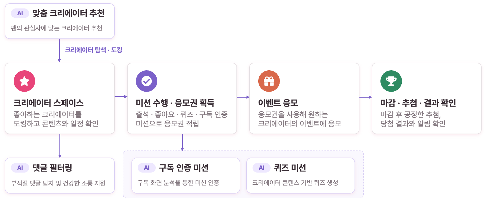
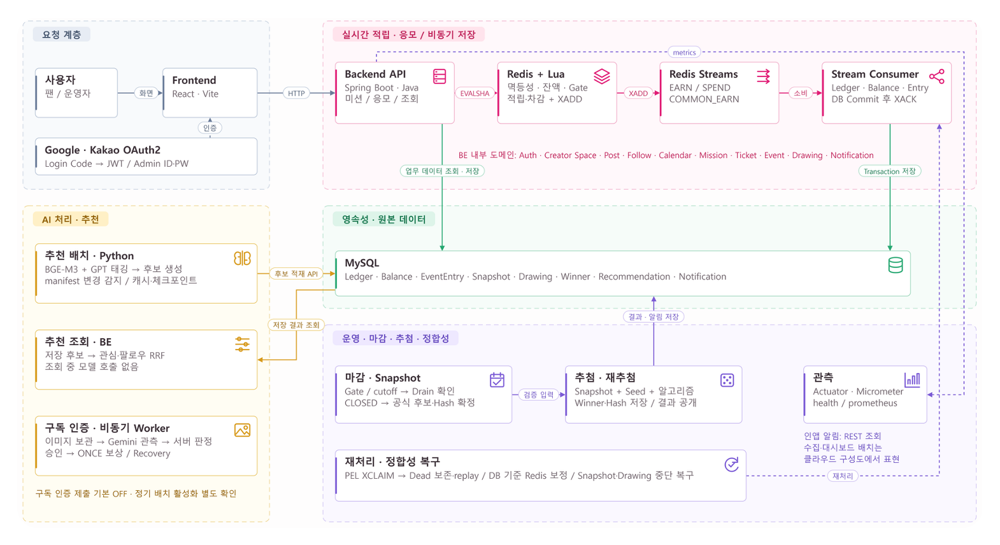
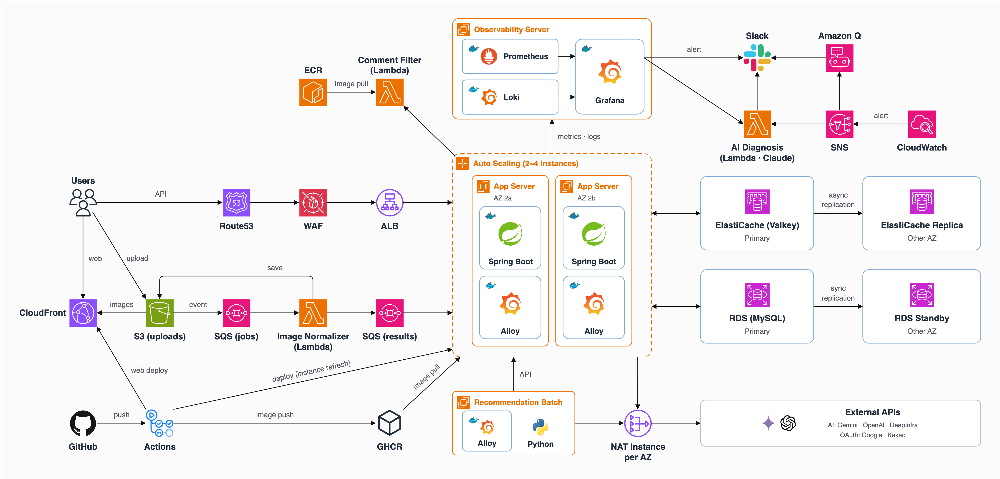
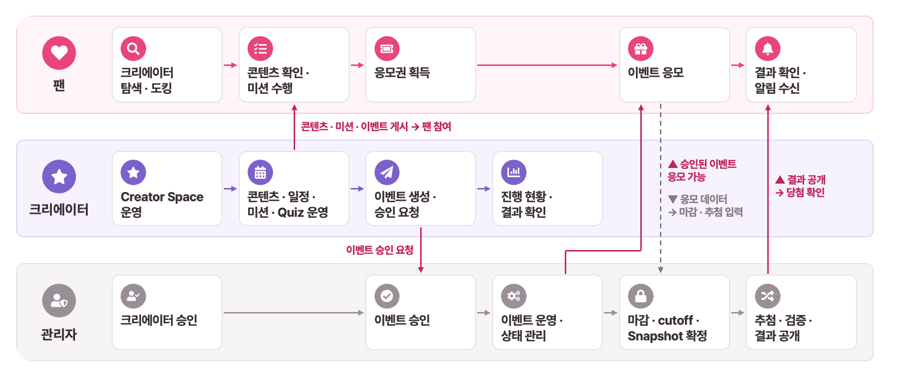
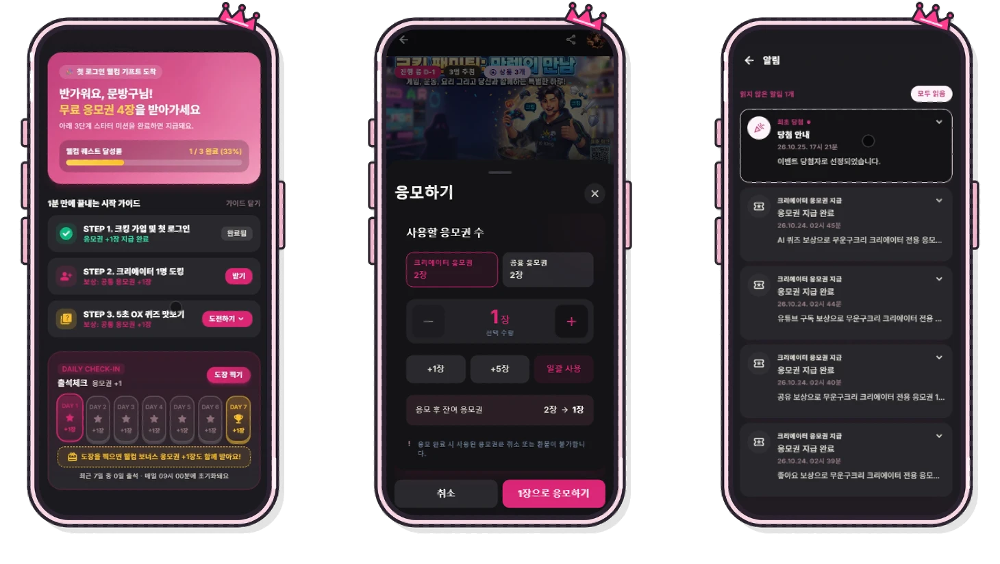
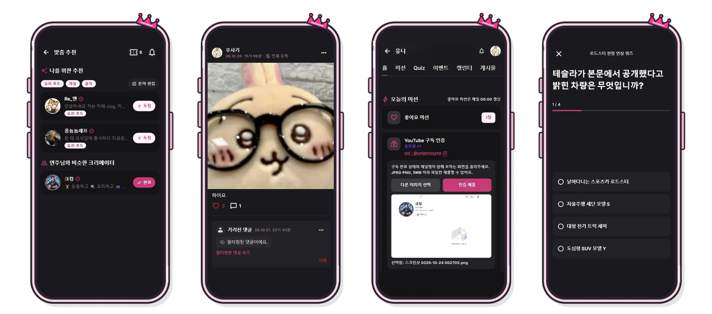

<div align="center">
  

  <br />

  <h3>크리에이터와 팬을 잇는 팬 참여형 이벤트 플랫폼</h3>
  <p>좋아하는 크리에이터를 발견하고, 미션으로 응모권을 획득하며,<br />이벤트 응모부터 검증 가능한 추첨과 당첨 결과 확인까지 하나의 흐름으로 연결합니다.</p>

  <br />

  <p><a href="https://cking.co.kr"></a></p>
  <p><a href="https://github.com/URECA-Cking/Cking-FE"></a></p>
  <p><a href="https://github.com/URECA-Cking/Cking-Infra"></a></p>
  <p><a href="https://youtu.be/WEKKLaadHcM"></a></p>
</div>

---

<h2 align="center">프로젝트 소개</h2>

<div align="center">
  <p>CKing은 SNS 곳곳에 흩어진 크리에이터 콘텐츠와 이벤트를 한곳에서 탐색하고,<br />팬의 참여를 미션·응모권·추첨으로 연결하는 플랫폼입니다.</p>

  <p>크리에이터는 전용 Space에서 콘텐츠와 일정을 운영하고 이벤트를 개최하며,<br />팬은 관심 있는 크리에이터를 도킹하고 미션을 수행해 이벤트에 참여합니다.</p>

  <br />

  
</div>

<br />

## 서비스 한눈에 보기

<p>
  
</p>

<br />

## 시스템 아키텍처

<p>
  
</p>

- **실시간 처리:** Spring Boot API와 Redis Lua로 응모권 적립·차감, 중복 요청 검증, 이벤트 Gate 검사를 원자적으로 처리합니다.

- **비동기 영속화:** Redis Streams의 EARN·SPEND 이벤트를 Consumer가 처리하고, DB 커밋 후 XACK하여 실패 시 재처리할 수 있도록 설계했습니다.

- **운영 및 확장:** 마감·Snapshot·추첨·정합성 복구를 도메인별로 분리하고, Python 기반 추천 배치 및 비동기 AI 처리 파이프라인을 연동했습니다.

<br />

## 인프라 아키텍처

<p>
  
</p>

- **서비스 운영:** AWS ALB/WAF 및 다중 애플리케이션 인스턴스, RDS MySQL, ElastiCache(Valkey)를 활용합니다.

- **배포:** GitHub Actions 기반 CI/CD와 컨테이너 이미지 관리, S3·CloudFront 기반 프론트엔드 배포를 구성했습니다.

- **관측:** Prometheus·Grafana·Loki·CloudWatch 기반 지표·로그 수집과 알림을 연계했습니다.

<br />

## 개발 환경 및 기술 스택

| 구분 | 사용 기술 |
|:---:|---|
| Frontend | React, Vite, Tailwind CSS, PWA |
| Backend | Java 21, Spring Boot 4.1.1, Spring Security, Spring Data JPA, OAuth2, JWT, Springdoc OpenAPI |
| Data / Messaging | MySQL 8.4, Redis 7.2, Redis Lua, Redis Streams, Flyway |
| AI | Gemini(VLM·Quiz), OpenAI(GPT Judge·태깅), BGE-M3, Python 추천 배치, 댓글 필터링 파이프라인 |
| Infrastructure | AWS(EC2, ALB, WAF, RDS, ElastiCache/Valkey, S3, CloudFront, Lambda, Route 53), Docker, Terraform |
| Observability | Spring Actuator, Micrometer, Prometheus, Grafana, Loki, CloudWatch |
| Development | JDK 21, Node.js 22, Gradle, npm, Git, Docker Compose, S3Mock, Swagger UI |
| Testing / Quality | JUnit 5, Testcontainers, k6, Playwright, oxlint, node --test, actionlint |
| CI/CD | GitHub Actions, GHCR, Dependabot, S3·CloudFront 배포 |

<br />

## 서비스 전체 동작 흐름

<p>
  
</p>

관리자는 크리에이터 전환 신청과 이벤트를 심사하고, 크리에이터는 Creator Space에서 게시물·일정·미션·퀴즈·이벤트를 운영합니다. 팬은 관심 있는 크리에이터를 도킹하고 미션으로 응모권을 획득해 승인된 이벤트에 응모합니다. 마감 시 Redis Gate와 Stream cutoff로 신규 접수를 차단하고 처리 중인 응모의 DB 반영(Drain)을 기다린 뒤 공식 Snapshot을 확정합니다. 이후 저장된 Seed로 가중 추첨을 실행하고 Hash로 입력과 결과를 검증해 당첨 결과를 공개하고 알림을 전달합니다.

<br />

## 핵심 기능 및 설계

<p>
  
</p>

### 1. 응모권 획득 — 중복 없는 적립과 장애 복구

- **두 겹의 중복 방지:** `requestId`와 요청 fingerprint로 재전송을 판별하고, 사용자·미션·보상 기간 단위 Guard로 서로 다른 요청 ID의 중복 보상도 차단합니다.
- **Redis Lua 원자성:** Guard 확인, Redis 잔액 증가, EARN Stream 발행을 하나의 Lua 실행에 묶습니다. XADD가 실패하면 변경한 잔액과 예약 상태를 되돌립니다.

- **DB 확정 및 재처리:** Consumer가 완료 이력·Ledger·잔액을 하나의 트랜잭션으로 저장하고 커밋 후 XACK합니다. 실패 메시지는 PEL 회수·재처리 및 Dead Stream으로 추적합니다.

<sub>관련 문서: [Ticket](docs/domains/ticket/README.md) · [Mission](docs/domains/mission/README.md) · [Stream](docs/domains/stream/README.md)</sub>

### 2. 이벤트 응모 — 동시 요청에서도 잔액 정합성 유지

- **원자적 접수:** Redis Lua에서 이벤트 Gate·종료 시각·응모권 잔액을 검증하고, 차감 및 SPEND Stream 발행을 한 번에 처리합니다.
- **안전한 재시도:** 동일한 `requestId`와 동일한 요청은 기존 결과로 처리해 추가 차감을 방지하고, 요청 내용이 달라지면 충돌로 거절합니다.

- **비동기 이력 반영:** Consumer가 응모 내역·차감 Ledger·DB 잔액을 함께 확정하고, 마감 시에는 cutoff 이전에 승인된 응모의 반영 완료를 기다립니다.

<sub>관련 문서: [Event](docs/domains/event/README.md) · [Ticket](docs/domains/ticket/README.md)</sub>

### 3. 이벤트 마감·추첨 — 입력과 결과를 검증 가능한 형태로 확정

- **마감 경계:** `OPEN → CLOSING → CLOSED` 전이에서 Gate 차단과 Stream cutoff를 확정하고, Drain 완료 후 공식 Snapshot을 생성합니다.
- **재현 가능한 추첨:** 후보·상품을 고정한 Snapshot과 Seed를 저장합니다. 응모권 비례 가중 추첨에는 Fenwick Tree를 사용하며, 당첨자는 비복원 방식으로 선정합니다.

- **무결성 및 공개:** Snapshot·Input·Result Hash로 입력과 결과를 검증하고, 결과 공개와 당첨 알림을 같은 트랜잭션으로 처리합니다. 재추첨은 기존 Snapshot과 새로운 Seed를 사용합니다.

<sub>관련 문서: [Snapshot](docs/domains/snapshot/README.md) · [Drawing](docs/domains/drawing/README.md) · [Redraw](docs/domains/redraw/README.md)</sub>

### 핵심 기능 검증 결과

| 항목 | 발표 당시 측정 결과 |
|:---:|:---:|
| 응모 부하 조건 | 동시 요청자 50명 |
| 처리량 | 최대 578 TPS |
| 응답 지연 | p95 23ms |
| 오류율 | 0.0% |
| 데이터 정합성 | 음수 잔액·중복 차감·마감 후 신규 응모·Redis/DB 잔액 불일치 0건 |
| 가중 추첨 비교 | 후보 10,000명·당첨자 950명 조건: 티켓 배열 770.14ms → Fenwick Tree 5.62ms |

<sub>관련 문서: [부하 테스트 가이드](docs/operations/loadtest.md) · [추첨 벤치마크](docs/domains/drawing/weighted-random-benchmark.md)</sub>

<br />

## 추가 기능 및 서비스 확장

<p>
  
</p>

| 기능 | 주요 설계 및 구현 |
|---|---|
| **맞춤 크리에이터 추천** | Creator 소개를 BGE-M3로 임베딩하고 GPT 분야 태그를 조합해 후보를 생성·저장합니다. 조회 시 관심사·도킹 신호 등을 반영하며, 후보 생성과 실시간 조회를 분리했습니다. |
| **AI 댓글 필터링** | 댓글 저장 후 비동기로 규칙 검사·문맥 분류를 실행합니다. 개인정보·욕설·스팸 등을 차단하고, 수정 중 재판정 우회 방지 및 실패 재시도·관리자 조회를 제공합니다. |
| **YouTube 구독 인증 미션** | 업로드한 구독 화면을 VLM으로 분석하고 서버 정책으로 최종 승인 여부를 결정합니다. Processing Claim·고정 보상 요청 ID·Recovery를 통해 중복 지급을 방지합니다. |
| **AI 퀴즈 미션** | 영상 원문 추출·문항 생성(Gemini), 7가지 기준의 GPT Judge 평가, Creator 승인·게시, 팬 응시·서버 채점·보상까지 연결합니다. |
| **Creator Space** | 프로필·도킹·게시물·댓글·일정·미션·이벤트를 크리에이터별 공간에서 통합 운영합니다. |
| **비정상 행동 탐지** | Redis Lua 기반 최근 행동 집계로 반복 요청·잔액 부족·빠른 적립 후 사용 등 패턴을 탐지하고, MySQL Evidence와 관리자 검토 이력을 관리합니다. |

<sub>관련 문서: [추천](docs/domains/creator/similarity-recommendation.md) · [댓글](docs/domains/post/README.md) · [구독 인증](docs/domains/subscription-verification/README.md) · [AI Quiz](docs/domains/quiz/README.md) · [이상 탐지](docs/domains/abuse-detection/README.md)</sub>

<br />

## 베타 테스트 및 트러블슈팅

<details>
<summary><strong>베타 테스트 결과 및 피드백</strong></summary>

2026년 베타 테스트 발표 자료 기준 주요 지표입니다.

| 항목 | 결과 |
|---|---:|
| 고유 사용자 | 116명 |
| 세션 | 205회 |
| 모바일 세션 비율 | 85% |
| 세션당 페이지 수 | 11.82 |
| LCP | 1.32초 |
| INP | 192ms |
| CLS | 0.05 |
| JavaScript 오류 | 201세션 중 1세션 |

- **로그인 보안 피드백:** 로그인 코드 발급 브라우저와 교환 브라우저를 바인딩하지 않았던 문제를 전용 쿠키와 Lua 검증으로 개선했습니다.

- **캘린더 UX 피드백:** 날짜만 있는 일정을 표현할 수 있도록 종일 일정 입력·표시를 추가했습니다.

</details>

<br />

<details>
<summary><strong>트러블슈팅 01 — 조기 마감 이벤트가 다시 응모를 받던 문제</strong></summary>

- **문제:** 조기 마감 직후 Redis 접수 상태 키가 유실되면, 복원 작업이 DB의 이전 `OPEN` 상태를 읽어 이벤트 접수를 다시 열 수 있었습니다.

- **원인:** Redis Gate 차단과 DB의 `CLOSING` 반영 사이의 시간차 및 키 복원의 비원자적 확인·적재가 경합했습니다.

- **해결:** 복원 검증·적재를 Lua 원자 처리로 변경하고 cutoff 존재 여부로 마감 중인 이벤트의 재개방을 방지했습니다. cutoff 유실 시에도 마감 상태를 재확인해 차단합니다.

- **검증:** 마감·복원 경합을 통합 테스트 4건으로 재현하고, cutoff가 유지된 상황에서 재개방되지 않음을 확인했습니다.

</details>

<br />

<details>
<summary><strong>트러블슈팅 02 — 매 정각 응모 응답이 지연되던 문제</strong></summary>

- **문제:** 정각마다 응모 응답이 최대 1.5~3초 지연되고, 1초 내 DB 반영률은 91.9%에 머물렀습니다.

- **원인:** 버스터블 애플리케이션 인스턴스에서 정각 CPU steal(빼앗긴 CPU 시간)이 최대 79%로 관찰되었습니다.

- **해결:** 서버를 `c6g.large`로 변경하고 1초 단위 지표로 재측정하여 서버 종류의 영향을 분리했습니다.

- **결과:** CPU steal 79% → 0%, 정각 응답 지연 1.5~3초 → 0.25~1초, 1초 내 DB 반영률 91.9% → 99.78%로 개선되었습니다.

</details>

<br />

## 로컬 실행 및 개발 가이드

### 사전 준비

- Git, **JDK 21**, Docker Desktop 설치
- IDE 및 터미널에서 `git --version`, `java -version`, `docker compose version` 확인

### 프로젝트 준비

```bash
git clone https://github.com/URECA-Cking/Cking-BE.git
cd Cking-BE
git switch develop
docker compose up -d
```

`docker-compose.yml`은 MySQL 8.4(3306), Redis 7.2(6379), S3Mock(9090)을 실행합니다. 로컬 DB는 `cking` 데이터베이스/계정을 사용하고, S3Mock 버킷은 `cking-local-uploads`입니다. 로컬 개발용 값은 반드시 운영 자격 증명과 분리합니다.

### 애플리케이션 실행

먼저 `openssl rand -base64 32` 등으로 `JWT_SECRET`을 생성합니다. 실제 시크릿 값을 Git 저장소·로그·PR에 넣지 않습니다.

**macOS / Linux**

```bash
export JWT_SECRET='...'
./gradlew bootRun
```

**Windows PowerShell**

```powershell
$env:JWT_SECRET='...'
.\gradlew.bat bootRun
```

선택 기능을 사용할 때만 관련 환경변수를 추가합니다.

| 기능 | 주요 환경변수 |
|---|---|
| Google·Kakao 로그인 | `SPRING_PROFILES_ACTIVE=local,oauth`, `OAUTH_GOOGLE_CLIENT_ID`, `OAUTH_GOOGLE_CLIENT_SECRET`, `OAUTH_KAKAO_CLIENT_ID`, `OAUTH_KAKAO_CLIENT_SECRET` |
| YouTube 채널 연결 | `OAUTH_YOUTUBE_CLIENT_ID`, `OAUTH_YOUTUBE_CLIENT_SECRET`, `OAUTH_YOUTUBE_API_KEY` |
| AI 퀴즈 생성 | `GEMINI_API_KEY` |
| 구독 인증 제출 | `SUBSCRIPTION_VERIFICATION_SUBMISSION_ENABLED=true`, `SUBSCRIPTION_GEMINI_API_KEY` |

`GEMINI_API_KEY` 없이도 서버는 시작할 수 있지만, AI 퀴즈 생성 호출은 Provider 오류가 발생합니다. 모델·타임아웃·재시도 설정은 [AI Quiz](docs/domains/quiz/README.md)와 [구독 인증](docs/domains/subscription-verification/README.md) 문서를 참고하세요.

### API 및 테스트

- 로컬 Swagger UI: <http://localhost:8080/swagger-ui/index.html>
- 개발 Swagger UI: <https://dev-api.cking.co.kr/swagger-ui/index.html>

```bash
./gradlew test          # macOS / Linux
.\gradlew.bat test       # Windows PowerShell
```

테스트 프로필에서는 HikariCP 최대 연결 수를 3으로 제한합니다. 통합 테스트에 필요한 MySQL·Redis 컨테이너가 실행 중인지 확인하세요.

### 종료 및 데이터 정리

```bash
docker compose down       # 컨테이너만 종료
docker compose down -v    # 로컬 DB·S3Mock 볼륨까지 삭제
```

**주의:** `-v`는 로컬 DB 데이터와 S3Mock 저장 데이터를 삭제합니다.

### 코드 구조 및 협업

도메인별로 `presentation / application / domain / repository` 계층을 사용하며, 상태 변경은 소유 도메인의 서비스를 통해 수행합니다. API·설계 문서는 [문서 인덱스](docs/README.md), 커밋·브랜치·PR 규칙은 [CONTRIBUTING.md](https://github.com/URECA-Cking/.github/blob/main/CONTRIBUTING.md)를 참고하세요.

작업은 `develop`에서 `<타입>/<이슈번호>-<요약>` 브랜치를 생성하고, 리뷰 후 `develop`에 Squash and merge하는 절차를 따릅니다. `main`과 `develop`에는 직접 push하지 않습니다.

<br />

## 팀원

| 이름 | 담당 영역 | 핵심 기여 |
|:---:|---|---|
| 권혁준 (팀장) | | |
| 김태연 | | |
| 이성집 | | |
| 장근창 | | |
| 정문구 | | |
| 정윤희 | | |
| 정자비 | | |
| 조성원 | | |
